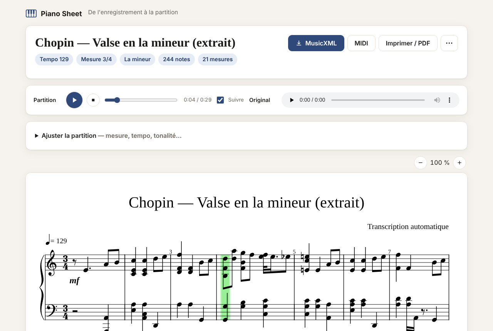

# Piano Sheet 🎹

**Transformez un enregistrement de piano (MP3, WAV, FLAC…) en partition.**

Vous écoutez un morceau de piano et vous ne trouvez sa partition nulle part ? Envoyez le fichier audio :
Piano Sheet repère chaque note jouée grâce à un réseau de neurones spécialisé, puis écrit la partition
pour vous — tempo, mesure, tonalité, main droite et main gauche — prête à être lue, écoutée, imprimée
ou corrigée dans [MuseScore](https://musescore.org/fr).



## Fonctionnalités

- **Interface web** : glisser-déposer d'un fichier, suivi de la progression, partition affichée dans le
  navigateur, lecture avec un vrai son de piano et curseur qui suit la partition, impression / PDF.
- **Ajustements instantanés** : si le tempo, la mesure ou la tonalité détectés ne conviennent pas, changez-les
  et la partition est réécrite en une seconde, sans refaire la transcription.
- **Ligne de commande** pour traiter des fichiers sans navigateur.
- **Exports** : MusicXML (s'ouvre dans MuseScore, Sibelius, Finale, Dorico…), MIDI de la partition et MIDI
  « brut » de l'interprétation (avec la pédale).
- Formats acceptés : MP3, WAV, FLAC, OGG, M4A/AAC, OPUS, AIFF… et MIDI (pour mettre en partition un fichier
  MIDI existant).

## Comment ça marche

```
 fichier audio ──► notes jouées ──► temps et mesures ──► rythme écrit ──► deux mains ──► partition
   (ffmpeg)        (réseau de        (suivi du tempo,     (quantification   (séparation    (MusicXML,
                    neurones)         même en rubato)      temps par temps)  main D / G)    MIDI)
```

1. **Transcription** — Le modèle *High-resolution Piano Transcription* (Kong et al., ByteDance, 2021), entraîné
   sur plus de 200 heures de piano (jeu de données MAESTRO), détecte chaque note avec son attaque, sa fin et
   son intensité, ainsi que la pédale.
2. **Rythme** — Les temps sont suivis tout au long du morceau, ce qui permet de suivre un interprète qui
   ralentit ou accélère. La mesure (2/4, 3/4, 4/4, 6/8…) et l'emplacement des barres de mesure sont déduits
   des répétitions d'une mesure à l'autre et du mouvement de la basse.
3. **Quantification** — Chaque temps reçoit la grille rythmique qui lui convient le mieux (croches,
   doubles-croches, triolets, sextolets…), séparément pour chaque main : des croches contre des triolets
   restent lisibles.
4. **Mains** — Les notes sont réparties entre la main droite (clé de sol) et la main gauche (clé de fa) en
   tenant compte de l'écart des mains et de la continuité des lignes mélodiques.
5. **Écriture** — Tonalité (et donc orthographe : *do♯* ou *ré♭*), liaisons de prolongation aux bons
   endroits, changements de clé, signes *8va* pour les passages très aigus, nuances (*p*, *mf*, *f*…).

## Installation

### Avec Docker (le plus simple)

```bash
docker compose up --build
```

Puis ouvrez <http://localhost:8000>. Le modèle de transcription est inclus dans l'image.

### Avec Python (3.10 ou plus récent)

Prérequis : [ffmpeg](https://ffmpeg.org/download.html) (pour lire les MP3, M4A…).

```bash
python -m venv .venv
source .venv/bin/activate            # Windows : .venv\Scripts\activate

# PyTorch version CPU (plus légère). Avec une carte graphique NVIDIA, suivez https://pytorch.org.
pip install torch --index-url https://download.pytorch.org/whl/cpu
pip install -e .

piano-sheet download-model           # télécharge le modèle (~165 Mo), sinon fait au premier usage
```

## Utilisation

### Interface web

```bash
piano-sheet serve                    # http://127.0.0.1:8000
piano-sheet serve --host 0.0.0.0 --port 8000 --data-dir ./data
```

### Ligne de commande

```bash
piano-sheet transcribe "Mon morceau.mp3"
piano-sheet transcribe morceau.mp3 -o partitions/ --title "Ma valse" --time-signature 3/4 --key "Eb"
```

Produit, à côté du fichier ou dans le dossier `-o` :

| Fichier | Contenu |
| --- | --- |
| `morceau.musicxml` | La partition, à ouvrir avec MuseScore (gratuit) pour l'afficher, la corriger ou l'imprimer |
| `morceau.mid` | La partition au format MIDI |
| `morceau.transcription.mid` | Les notes exactement comme elles ont été jouées (avec pédale) |

Options :

| Option | Effet |
| --- | --- |
| `--title` | Titre de la partition (par défaut : le nom du fichier) |
| `--time-signature`, `-t` | Mesure : `2/4`, `3/4`, `4/4`, `6/8`, `9/8`, `12/8` (détectée sinon) |
| `--bpm` | Tempo en battements par minute (détecté sinon) |
| `--key`, `-k` | Tonalité : `C`, `Eb`, `f#`, `Bb minor`, `la mineur`… (détectée sinon) |
| `--no-dynamics` | Ne pas écrire de nuances |
| `--min-velocity` | Ignorer les notes très faibles (12 par défaut, 0 pour tout garder) |
| `--device` | `cpu` ou `cuda` (automatique par défaut) |

### Configuration du serveur

| Variable d'environnement | Défaut | Rôle |
| --- | --- | --- |
| `PIANO_SHEET_DATA_DIR` | `data` | Fichiers envoyés et partitions produites |
| `PIANO_SHEET_MODEL_DIR` | `~/.cache/piano-sheet` | Emplacement du modèle |
| `PIANO_SHEET_MAX_UPLOAD_MB` | `50` | Taille maximale d'un fichier envoyé |
| `PIANO_SHEET_MAX_DURATION_MIN` | `20` | Durée maximale d'un enregistrement |
| `PIANO_SHEET_RETENTION_HOURS` | `72` | Les transcriptions plus anciennes sont supprimées au démarrage (`0` : jamais) |
| `PIANO_SHEET_PRELOAD_MODEL` | `1` | Charger le modèle dès le démarrage |

## Conseils pour de bons résultats

- **Piano seul** : le modèle est entraîné sur du piano solo. Chant, autres instruments ou batterie donnent des
  notes parasites.
- **Bonne qualité** : un enregistrement net, sans trop de réverbération ni de bruit, donne une meilleure
  transcription.
- **Ajustez si besoin** : si la partition semble deux fois trop rapide (ou lente), indiquez le tempo que vous
  entendez ; si les barres de mesure tombent mal, choisissez la mesure. La réécriture est instantanée.
- **Temps de calcul** : sans carte graphique, comptez environ une minute de calcul par minute de musique
  (une dizaine de secondes avec une carte graphique NVIDIA).

## Qualité et limites

Le script [`scripts/evaluate.py`](scripts/evaluate.py) mesure la qualité de bout en bout : des partitions
connues sont jouées par un piano échantillonné (FluidSynth) avec des imprécisions humaines (rubato, décalages,
nuances), encodées en MP3, retranscrites, puis comparées à l'original.

| Morceau | Hauteurs justes | Rythmes justes | Bonne main | Mesure | Barres de mesure |
| --- | --- | --- | --- | --- | --- |
| Bach, Prélude en do majeur BWV 846 | 100 % | 100 % | 88 % | 4/4 ✓ | ✓ |
| Chopin, Mazurka op. 6 n° 2 | 96 % | 93 % | 89 % | 3/4 ✓ | ✓ |
| Schubert, *Der Lindenbaum* (piano) | 96 % | 88 % | 96 % | 3/4 ✓ | ✓ |
| Schumann, *Dichterliebe* n° 2 (piano) | 97 % | 97 % | 82 % | 4/4 (2/4 attendu) | ✓ |

Sur un véritable enregistrement (Chopin, Valse en la mineur B. 150 par Aya Higuchi, Musopen, CC0), la
tonalité, la mesure à 3/4 et l'accompagnement « oum-pa-pa » sont correctement retrouvés.

Une partition produite automatiquement reste un **premier jet** à relire :

- chaque main est écrite sur une seule voix : une note tenue pendant que d'autres bougent dans la même main est
  raccourcie ;
- le tempo peut être noté au double ou à la moitié (croches au lieu de doubles-croches, par exemple) ;
- les ornements (trilles, appogiatures) sont écrits en notes réelles ;
- les mesures composées ou changeantes, les fermates et les très forts rubatos peuvent dérouter la détection.

## Développement

```bash
pip install -e ".[dev]"
pytest                               # le test du modèle est ignoré s'il n'est pas téléchargé
python scripts/evaluate.py --keep /tmp/eval   # banc d'essai (nécessite fluidsynth et une SoundFont)
```

Organisation du code (`src/piano_sheet/`) :

| Module | Rôle |
| --- | --- |
| `audio.py` | Décodage de l'audio (ffmpeg) |
| `transcriber.py` | Réseau de neurones : audio → notes, téléchargement du modèle |
| `notes.py` | Notes jouées (en secondes), lecture et écriture MIDI |
| `rhythm.py` | Suivi des temps, détection de la mesure, quantification |
| `hands.py` | Répartition main droite / main gauche |
| `keys.py` | Tonalité et orthographe des notes |
| `score.py` | Écriture de la partition (music21) |
| `pipeline.py` | Enchaînement des étapes |
| `server.py`, `static/` | Application web (FastAPI + OpenSheetMusicDisplay + Tone.js) |
| `cli.py` | Ligne de commande |

## Crédits et licences

- Modèle de transcription : Qiuqiang Kong, Bochen Li, Xuchen Song, Yuan Wan, Yuxuan Wang,
  *High-resolution Piano Transcription with Pedals by Regressing Onset and Offset Times*, IEEE/ACM TASLP 2021 —
  poids publiés sur [Zenodo](https://zenodo.org/records/4034264) sous licence CC BY 4.0, utilisés via
  [piano_transcription_inference](https://github.com/qiuqiangkong/piano_transcription_inference).
- [music21](https://web.mit.edu/music21/) (BSD) pour l'écriture MusicXML, [librosa](https://librosa.org/) (ISC)
  pour le suivi des temps.
- Dans le navigateur : [OpenSheetMusicDisplay](https://opensheetmusicdisplay.org/) (BSD),
  [Tone.js](https://tonejs.github.io/) (MIT) et les échantillons de piano *Salamander Grand Piano*
  d'Alexander Holm (CC BY 3.0).
